# 🐾 Entre Patas


## Sobre o projeto

O **Entre Patas** é um projeto acadêmico de aplicativo para adoção de animais, desenvolvido para apresentação no Summit da Universidade de Mogi das Cruzes (UMC).

A proposta é aproximar adotantes, animais e organizações de acolhimento por meio de uma experiência digital acessível. O aplicativo conta com a proposta de um questionário de compatibilidade, que ajuda o usuário a refletir sobre seu perfil e as necessidades do animal antes de solicitar a adoção.

O projeto busca contribuir para adoções mais conscientes, oferecendo informações sobre os animais, pesquisa por região e acompanhamento das solicitações.

## Objetivos

- Facilitar a descoberta de animais disponíveis para adoção.
- Apoiar escolhas responsáveis por meio de um teste de compatibilidade.
- Disponibilizar perfis detalhados dos animais e dos responsáveis pelas publicações.
- Permitir que adotantes enviem e acompanhem solicitações.
- Oferecer às organizações recursos para cadastrar e gerenciar animais.

## Funcionalidades previstas

| Área | Funcionalidades |
|---|---|
| **Acesso** | Boas-vindas, cadastro, login e recuperação de senha. |
| **Usuário** | Perfil do adotante e edição de dados. |
| **Animais** | Listagem, pesquisa, filtros e ficha detalhada. |
| **Compatibilidade** | Questionário de preferências e indicação de afinidade com os animais. |
| **Adoção** | Solicitação com identificação do animal, publicador e adotante, data/hora e acompanhamento de status. |
| **Organizações** | Perfil de abrigo/lar e cadastro e gestão de animais. |
| **Comunicação** | Notificações sobre atualizações do processo; chat previsto no escopo de telas. |

> **Observação:** esta tabela representa o escopo do produto. A existência de uma tela no Figma não comprova que sua lógica esteja implementada no Flutter.

## Como executar o projeto

O projeto pode ser acessado diretamente pelo navegador, por meio do seguinte link:

🌐 [**Entre Patas – Acessar aplicação**](https://entre-patas-seven.vercel.app)

Caso prefira executar o projeto localmente, será necessário instalar as seguintes ferramentas:

- Git: para clonar o repositório.
- Flutter SDK: para executar e desenvolver a aplicação.

Após instalar os requisitos, siga as instruções de configuração e execução do projeto.


Estas são instruções gerais para um projeto Flutter. Dependências, variáveis de ambiente e configurações específicas devem ser verificadas no repositório.

```bash
# 1 - Clonar repositório do GitHub:
git clone https://github.com/AraujoCaua-jpg/Entre-Patas-main.git

# 2 - Abrir projeto no VS Code:
cd Entre-Patas-main

# 3 - Verificar se está tudo certo com o ambiente:
flutter doctor

# 4 - Instalar dependências e pacotes do flutter para o projeto
flutter pub get

# 5 - Para fazer o programa rodar localmente via Chrome:
flutter run -d chrome --dart-define-from-file=config/production.json

```

### Exemplo de jornada: adoção do Bolt

1. O usuário encontra Bolt na listagem ou na pesquisa.
2. Abre a ficha para consultar fotos, descrição, porte, idade, localização e informações de saúde.
3. Visualiza uma indicação de compatibilidade (por exemplo, **95%**, valor ilustrativo utilizado no protótipo).
4. Seleciona **“Quero adotar o Bolt”**.
5. Confere o animal, quem publicou, seus dados e os detalhes da solicitação.
6. Envia a solicitação e acompanha o andamento até a conclusão do processo.

> Os nomes, percentuais, datas e dados pessoais apresentados nos mockups são exemplos de demonstração, não registros reais.

## Tecnologias e ferramentas

| Tecnologia/Ferramenta | Utilização |
|---|---|
| **Flutter** | Desenvolvimento da interface do aplicativo. |
| **Dart** | Linguagem de programação. |
| **Figma** | Prototipação UX/UI e navegação entre telas. |
| **Git e GitHub** | Versionamento e colaboração. |
| **Trello** | Organização de tarefas e sprints. |
| **Banco de dados** | Persistência de usuários, animais e adoções. A tecnologia e a integração final ainda precisam ser confirmadas. |

A organização do código em `models` e `controllers` faz parte da abordagem de desenvolvimento discutida pela equipe. A estrutura efetiva do repositório deve ser confirmada no código-fonte.

## Demonstração do Aplicativo

A seguir, estão algumas capturas de tela do sistema, apresentando suas principais funcionalidades e interfaces.

### 1. Boas Vindas
Apresenta a página o qual o usuário escolhe se vai fazer login ou entrar no aplicativo.

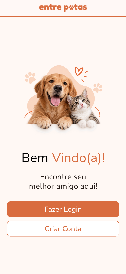

### 2. Tela de Login
Permite que o usuário acesse sua conta por meio de suas credenciais, garantindo acesso às funcionalidades personalizadas do sistema.

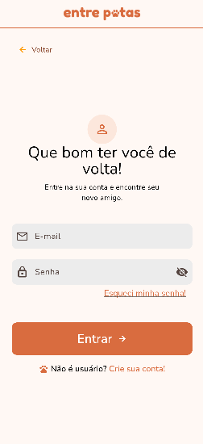

### 3. Esqueci minha senha
Telas que permitem que o usuário troque a senha em caso de esquecimento.

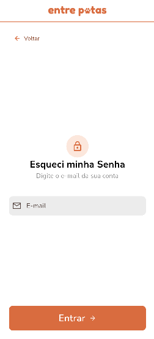 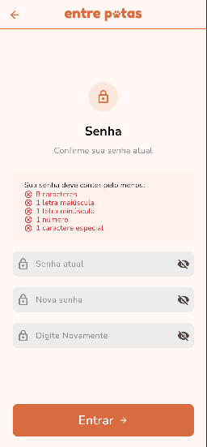

### 4. Telas de Cadastro
Possibilita o preenchimento das informações necessárias para realizar um novo cadastro no sistema.

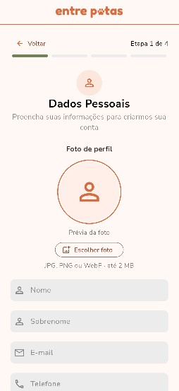 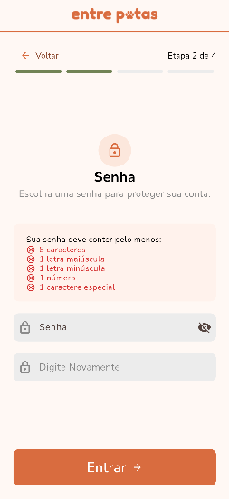 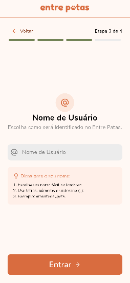 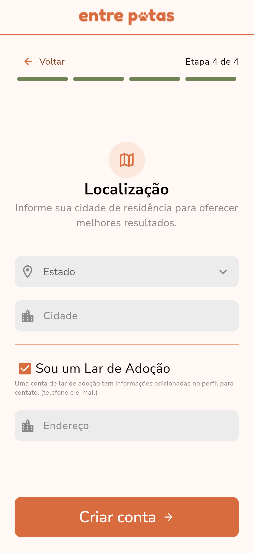

### 5. Teste de Compatibilidade
Teste que é usado para calcular a porcentagem de compatibilidade com o animal de acordo com suas preferências e rotina.

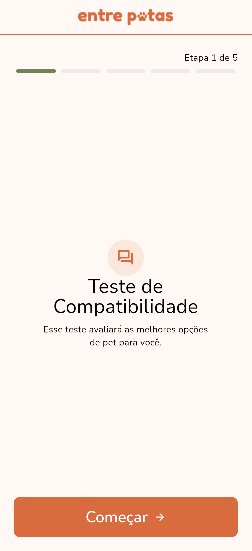 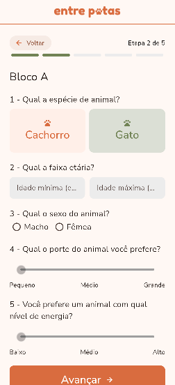 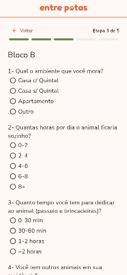 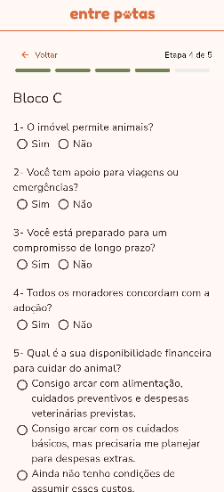 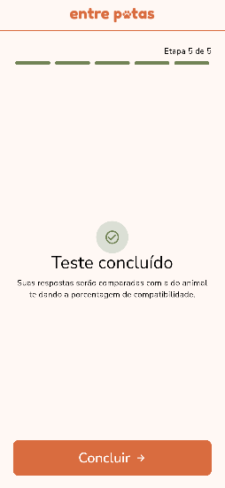

### 6. Home - Tela Inicial
Exibe as principais opções de animais baseado na suas preferências e rotinas.

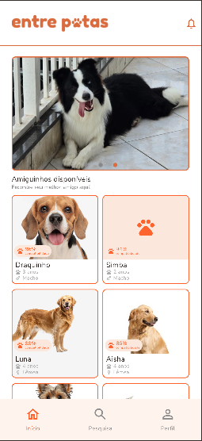

## 7. Pesquisa
Permite pesquisar entre animais e usuários com filtros de busca.

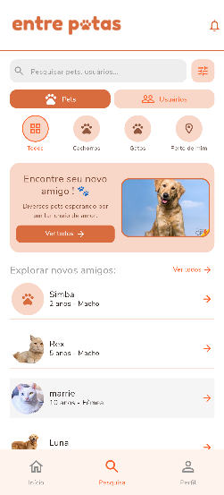 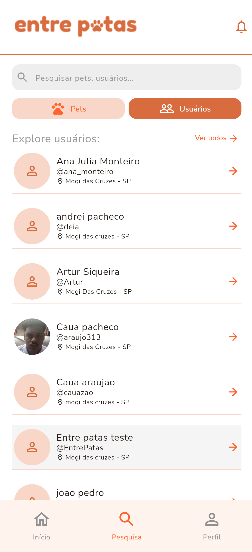 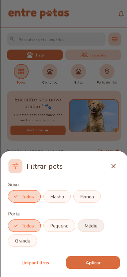

## 8. Perfil
Mostra o que é exibido para os outros na sua página de perfil, e permite alterar seus dados de cadastro. 

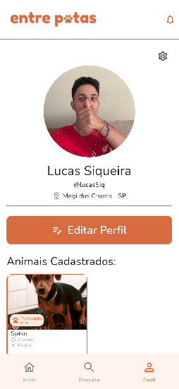 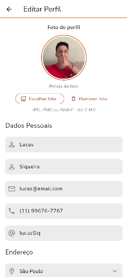

A tela da ficha de perfil é exibida quando outros usuários acessam sua página.

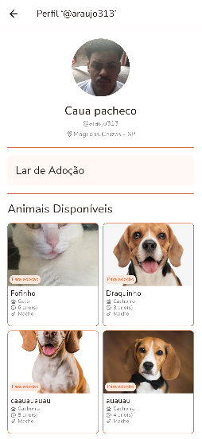

## 9. Notificações
Exibe as adoções realizadas o qual o usuário participa.

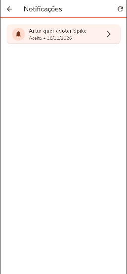

Nessa tela, o usuário pode visualizar a ficha de adoção, que mostra os status e as informações do processo.

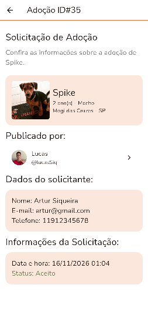

## 10. Configurações
Exibe funções de alteração de conta, como editar, refazer teste ou apagar.

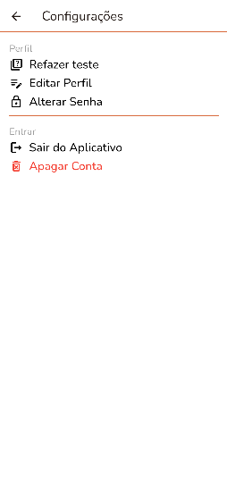

## 11. Animais
Funções para editar, apagar ou ccadastrar novos animais no sistema.

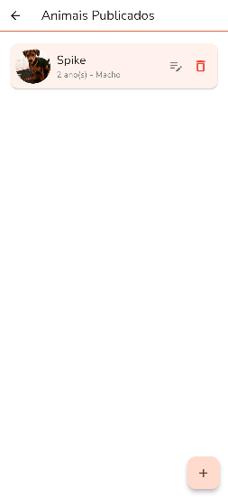 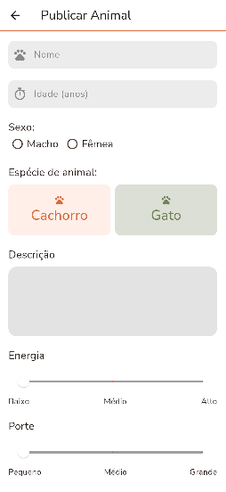 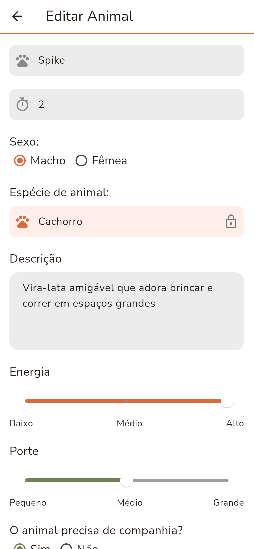

A tela de ficha do animal, é exibida quando outros usuários acessam a página do pet.

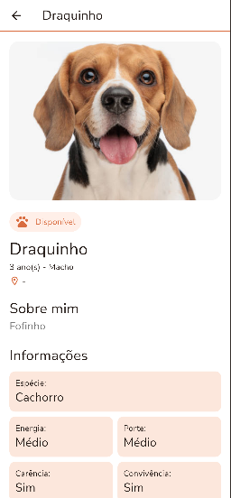

## Testes recomendados

- Cadastro, autenticação e validação de campos;
- Criação, consulta, edição e remoção autorizada de registros;
- Carregamento de animais e filtros de pesquisa;
- Navegação entre telas e carrossel de fotos;
- Cálculo e apresentação da compatibilidade;
- Envio de solicitações sem duplicidade acidental;
- Registro de data/hora, mudanças de status e notificações;
- Tratamento de erros e responsividade.

## Contexto acadêmico

Projeto desenvolvido para apresentação no Summit da Universidade de Mogi das Cruzes (UMC), com aplicação de conceitos de desenvolvimento de software, prototipação de interfaces e organização ágil de projetos.

## Equipe de Desenvolvimento

| Integrante | Atuação apresentada | GitHub |
|---|---|---|
| Cauã Araújo Marques | Desenvolvimento e integração | <a href="https://github.com/AraujoCaua-jpg"></a> |
| Lucas Alves Siqueira | UX/UI Design e prototipação | <a href="https://github.com/LucasSiq31"></a> |
| Yasmim Camilli da Silva Pacheco | Planejamento e desenvolvimento | <a href="https://github.com/YasmimPacheco"></a> |

**Orientadores:** Alessandra da Silva Martins e Higor Barreto Campos.

